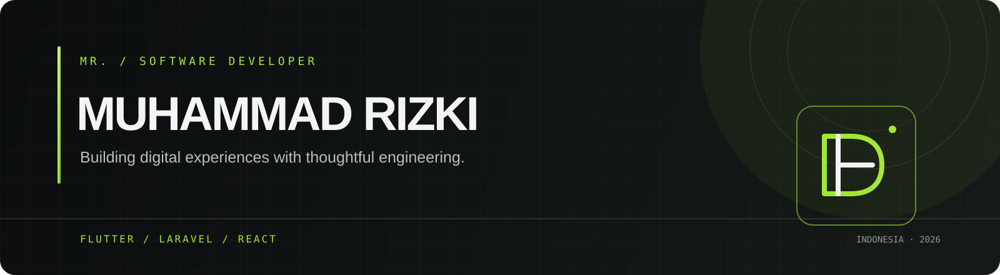

  <!-- Ganti src ini dengan banner custom buatan lo sendiri (ukuran 1500x400px) -->

  
  

    
  

  <!-- Social Badges (Lebih minimalis dan elegan) -->
  

    
    
    
    <!-- Ganti link ini dengan link portfolio/website lo kalau ada -->
    
  

---

### 👨‍💻 About Me

> *"Building practical solutions with clean code and intuitive design."*

- 🎓 **Education:** Informatics Engineering Student | Focused on Software Engineering.
- 🚀 **Current Focus:** Building scalable cross-platform mobile apps (Flutter) & robust fullstack web systems (Laravel/React).
- 💡 **My Philosophy:** I don't just write code; I build digital products that solve real-world problems with a strong emphasis on UI/UX.
- 🌱 **Currently Exploring:** Cloud deployment, CI/CD pipelines, and advanced state management in Flutter.
- ⚡ **Fun Fact:** I believe the best code is the one that is easy to read and maintain.

---

### 🛠️ Tech Stack & Tools
Tools and technologies I use across different parts of the development process.

 

---

### 📌 Featured Projects

<table width="100%">
  <tr>
    <td width="50%" valign="top">
      <h3 align="center">📱 Djajan Mobile</h3>
      

        
        
      

      
<b>Empowering Local UMKM.</b> A mobile app for Desa Kreyongan Atas micro-enterprises to showcase products and manage direct orders seamlessly.

      

        <a href="https://github.com/bgnrstudents/djajan-mobile"><b>View Repository →</b></a>
      

    </td>
    <td width="50%" valign="top">
      <h3 align="center">🌾 HayFarm System</h3>
      

        
        
      

      
<b>Teaching Factory (TEFA) System.</b> Comprehensive livestock data management and operational reporting system for HayFarm.

      

        <a href="https://github.com/bgnrstudents/HayFarm"><b>View Repository →</b></a>
      

    </td>
  </tr>
</table>

### 📊 GitHub Analytics & Activity

---

### 📊 Daily Contribution Activity
<!-- Snake Animation dalam Table -->
<table align="center" style="border: 1px solid #30363d; border-radius: 10px; padding: 15px;">
  <tr>
    <td>

    </td>
  </tr>
</table>

---

   
  

    
  

  
<i>"Keep growing. Keep adapting. Or fade away."</i>

  
© 2026 Muhammad Rizki · Built with ❤️ and ☕

